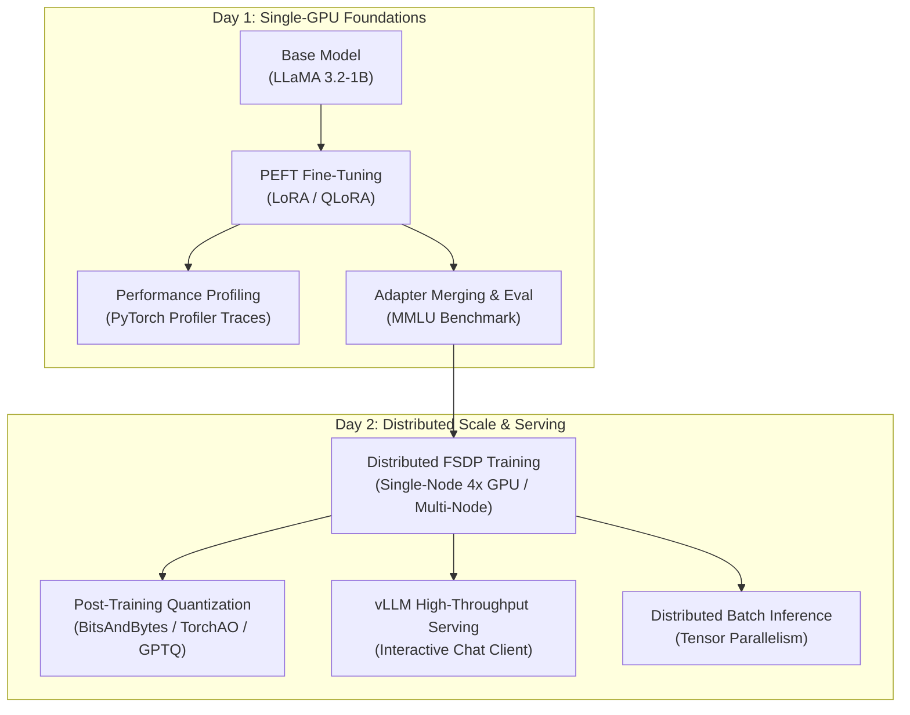

# LLM Fine‑tuning, Serving, and Inference on HPC

Welcome to the **LLM Fine‑tuning, Serving, and Inference on HPC** course! This repository provides a hands‑on guide to training, quantizing, evaluating, and deploying Large Language Models (LLMs) on High‑Performance Computing (HPC) clusters (specifically the **Olivia Supercomputer**).

All fine-tuning labs focus on **Question-Answering (QA)** using the Alpaca GPT-4 dataset.

---

## Course Overview

This course covers the full lifecycle of working with LLMs in an HPC environment—from single-GPU parameter-efficient fine-tuning (PEFT) to multi-node distributed training, post-training quantization, benchmark evaluation, and high-throughput vLLM serving.



## Course Program

### Day 1 — Single-GPU Fine-Tuning, Evaluation & Profiling
**Theme:** Build an efficient, reproducible single-GPU fine-tuning and evaluation workflow on an HPC system.

#### Morning Session (09:30–12:00) — HPC Fundamentals & Fine-Tuning Principles
- **HPC Foundations for LLM Workloads**
  - Architecture of the Olivia Supercomputer (NVIDIA Grace Hopper GH200 architecture)
  - Storage hierarchy: shared project shares, local `/tmp` scratch, and cache management
  - Software environments: Apptainer containers vs. native EESSI software modules
- **Parameter-Efficient Fine-Tuning (PEFT) Fundamentals**
  - Low-Rank Adaptation (LoRA): mathematical foundations, rank selection, and parameter efficiency
  - Quantized LoRA (QLoRA): 4-bit NormalFloat (NF4), double quantization, and dequantization
  - The Question-Answering (QA) benchmark task on the Alpaca GPT-4 dataset

#### Afternoon Session (13:00–15:30) — Hands-On: Single-GPU Workflow
- **End-to-End Fine-Tuning Workflow:**
  - Launching single-GPU LoRA and QLoRA fine-tuning jobs (Apptainer vs. EESSI)
  - Quantized fine-tuning trade-offs: FP4/NF4 memory savings vs. BF16 training throughput
- **Model Merging & Benchmark Evaluation:**
  - Merging trained LoRA adapter weights with base LLaMA weights into standalone Hugging Face checkpoints
  - Running MMLU benchmark evaluation with EleutherAI LM Evaluation Harness (comparing base model vs. fine-tuned adapter)
- **Performance Diagnostics & Monitoring:**
  - Real-time GPU monitoring with `gpu.monitor.sh` and interactive `nvitop`
  - Deep-dive PyTorch Profiler traces: memory timeline visualization and kernel analysis

#### Wrap-Up & Discussion (15:30–16:00)
**Outcome:** Participants implement, evaluate, and optimize a complete single-GPU QA fine-tuning pipeline with diagnostics, outputting structured artifacts to `results/checkpoint_results`, `results/profiling_results`, and `results/evaluation_results`.

---

### Day 2 — Distributed Training, Quantization, Serving & Inference
**Theme:** Scale fine-tuning across multiple GPUs and nodes, apply post-training quantization, and deploy high-throughput serving pipelines.

#### Morning Session (09:30–12:00) — Distributed Fine-Tuning, Evaluation & Profiling
- **Distributed Training Concepts & Interconnects**
  - PyTorch Fully Sharded Data Parallel (FSDP) vs. Distributed Data Parallel (DDP)
  - Inter-GPU interconnect topology: NVLink intra-node and HPE Slingshot / Cray Fabric inter-node
- **Hands-On: Multi-GPU & Multi-Node Fine-Tuning**
  - Single-node 4-GPU distributed LoRA, QLoRA, and Quantization-Aware Training (QAT-LoRA) with FSDP
  - Multi-node scaling across Slurm nodes with optimized AWS-OFI-NCCL network bindings
- **Hands-On: Distributed Evaluation & Profiling**
  - Multi-GPU MMLU evaluation of distributed checkpoints
  - Multi-rank profiling: identifying inter-GPU communication bottlenecks (all-reduce, reduce-scatter)

#### Afternoon Session (13:00–15:30) — Hands-On: Quantization, Serving & High-Throughput Inference
- **Hands-On: Post-Training Quantization (PTQ)**
  - Weight-only 4-bit and 8-bit quantization with BitsAndBytes
  - Modern kernel quantization using PyTorch TorchAO
  - Calibration-driven quantization with GPTQModel
- **Hands-On: LLM Serving with vLLM**
  - Deploying OpenAI-compatible vLLM API servers on single and multiple GPUs
  - Connecting and interacting with models via the terminal chat client (`chat.sh`)
- **Hands-On: High-Throughput Distributed Batch Inference**
  - Batch inference scaling with tensor parallelism in vLLM
  - Dynamic loading of trained LoRA adapters from `results/checkpoint_results/`

#### Wrap-Up & Discussion (15:30–16:00)
**Outcome:** Participants scale fine-tuned QA models across multiple GPUs and nodes, quantize models for edge/production constraints, evaluate performance on standard benchmarks, and deploy high-throughput vLLM serving on HPC clusters.

---

## Getting Started on Olivia

You only need a terminal. All labs are plain Slurm job scripts that you submit with `sbatch`.

### Step 1 — Log in and get the course files

```bash
ssh <username>@olivia.sigma2.no

mkdir -p /cluster/work/projects/nn9971k/$USER
cd /cluster/work/projects/nn9971k/$USER
git clone https://github.com/HichamAgueny/llm-hpc-course.git
cd llm-hpc-course
```

> [!IMPORTANT]
> Use exactly this folder: **`/cluster/work/projects/nn9971k/$USER/llm-hpc-course`**.
> The job scripts look for the course files there.

### Step 2 — Copy the models, datasets and containers (once, takes a few minutes)

```bash
./setup_env.sh
```

This copies the base model, the dataset and the two container images into your course folder
and creates the `results/` folders.

### Step 3 — Submit your first job

```bash
cd /cluster/work/projects/nn9971k/$USER/llm-hpc-course/day1_single_gpu/finetuning/lora_slurm
sbatch job_singleGPU_QA_LoRA.sh
```

Then follow it:

```bash
squeue --me                      # is my job waiting (PD) or running (R)?
tail -f out/*.out                # follow the job log (Ctrl+C to stop following)
./gpu.monitor.sh <JobID>         # live GPU usage while the job runs (Ctrl+C to stop)
```

That's it — every lab works the same way: **go to the lab folder, run `sbatch <script>`, read the log in `out/`.**

---

## The Labs at a Glance

Step-by-step instructions: **[Day 1 guide](./day1_single_gpu/README.md)** · **[Day 2 guide](./day2_multi_gpu/README.md)**

| Lab | Folder (inside `llm-hpc-course/`) | Script to submit |
| :--- | :--- | :--- |
| 1.1 LoRA fine-tuning (1 GPU) | `day1_single_gpu/finetuning/lora_slurm` | `job_singleGPU_QA_LoRA.sh` |
| 1.2 QLoRA fine-tuning (1 GPU) | `day1_single_gpu/finetuning/qlora_slurm` | `job_singleGPU_QA_QLoRA.sh` |
| 1.3 Profiling | `day1_single_gpu/profiling` | `job_singleGPU_QA_LoRA_profiling.sh` |
| 1.4 Merge + MMLU evaluation | `day1_single_gpu/evaluation` | `job_singleGPU_LoRA.sh` (base model: `job_singleGPU_No_LoRA.sh`) |
| 2.1 Fine-tuning on 4 GPUs | `day2_multi_gpu/fine-tuning/ft_single_node/lora_slurm` | `job_multiGPU_QA_LoRA.sh` |
| 2.2 Fine-tuning on 2 nodes | `day2_multi_gpu/fine-tuning/ft_multi_node/lora_slurm` | `job_multiNode_QA_LoRA.sh` |
| 2.3 Distributed profiling | `day2_multi_gpu/profiling` | `job_multiGPU_QA_LoRA.sh` |
| 2.4 Evaluation on 4 GPUs | `day2_multi_gpu/evaluation` | `job_multiGPU_LoRA.sh` |
| 2.5 Quantization | `day2_multi_gpu/quantization/quat_bitsandbytes` | `job_bnb_8bit.sh` |
| 2.6 vLLM serving + chat | `day2_multi_gpu/serving/single_device/vllm_container` | `serve_vllm.sh`, then `./chat.sh` |
| 2.7 Batch inference | `day2_multi_gpu/inference` | `slurm_vllm_distributed_container.sh` |

Most labs also have an **EESSI** version (software modules instead of a container): a script whose
name ends with `_eessi.sh`, in the same folder.

---

## Useful Slurm Commands

| Command | What it does |
| :--- | :--- |
| `sbatch <script>.sh` | Submit a job; prints its **JobID** |
| `squeue --me` | List your jobs (`PD` = waiting, `R` = running) |
| `scancel <JobID>` | Cancel a job |
| `tail -f out/*.out` | Follow the log of the jobs in the current lab folder |
| `./gpu.monitor.sh <JobID>` | Live GPU usage of a running job (also available as `utils/gpu.monitor.sh`) |

---

## Where to Find Your Results

Every job writes its **log** to the `out/` folder next to the script, and its **results** to:

```text
/cluster/work/projects/nn9971k/$USER/llm-hpc-course/results/
├── checkpoint_results/  # Fine-tuned adapters and training logs
├── profiling_results/   # PyTorch Profiler traces
└── evaluation_results/  # MMLU benchmark scores
```

---

## If a Job Fails

1. Read the end of the log: `tail -50 out/<job-name>-<JobID>.out`
2. `No such file or directory` for a model or dataset → run `./setup_env.sh` again (Step 2) and check
   that the course is in `/cluster/work/projects/nn9971k/$USER/llm-hpc-course`.
3. The evaluation / serving labs need a fine-tuned adapter: finish Lab 1.1 first.
4. Still stuck? Ask an instructor and show them the log file.

---

## Repository Layout

```text
llm-hpc-course/
├── setup_env.sh     # One-time setup: copies models, datasets and containers into your folder
├── apptainer/       # Container definitions (.def), build guide, and launch scripts
├── configs/         # YAML configurations (LoRA, QLoRA, QAT-LoRA, and Evaluation)
├── day1_single_gpu/ # Day 1 labs: Fine-Tuning, Evaluation, and Profiling
├── day2_multi_gpu/  # Day 2 labs: Distributed FT, Evaluation, Profiling, Quantization, Serving & Inference
├── recipes/         # Python programs used by the job scripts (training, merging, evaluation, quantization, vLLM)
├── utils/           # GPU monitoring tools (gpu.monitor.sh, nvitop)
└── README.md        # ← You are here
```

---

## Documentation Links

- [Day 1 Guide: Single-GPU Workflow](./day1_single_gpu/README.md)
  - [Day 1 Profiling Guide](./day1_single_gpu/profiling/README.md)
- [Day 2 Guide: Multi-GPU & Distributed Workflow](./day2_multi_gpu/README.md)
  - [Day 2 Profiling Guide](./day2_multi_gpu/profiling/README.md)
- [Configuration Guide (`configs/`)](./configs/README.md)
- [Python Recipes Guide (`recipes/`)](./recipes/README.md)
- [Apptainer Container Guide (`apptainer/`)](./apptainer/README.md)
- [Utilities & Monitoring Guide (`utils/`)](./utils/README.md)

---

## Contact
**Hicham Agueny** — [GitHub Profile](https://github.com/HichamAgueny)
