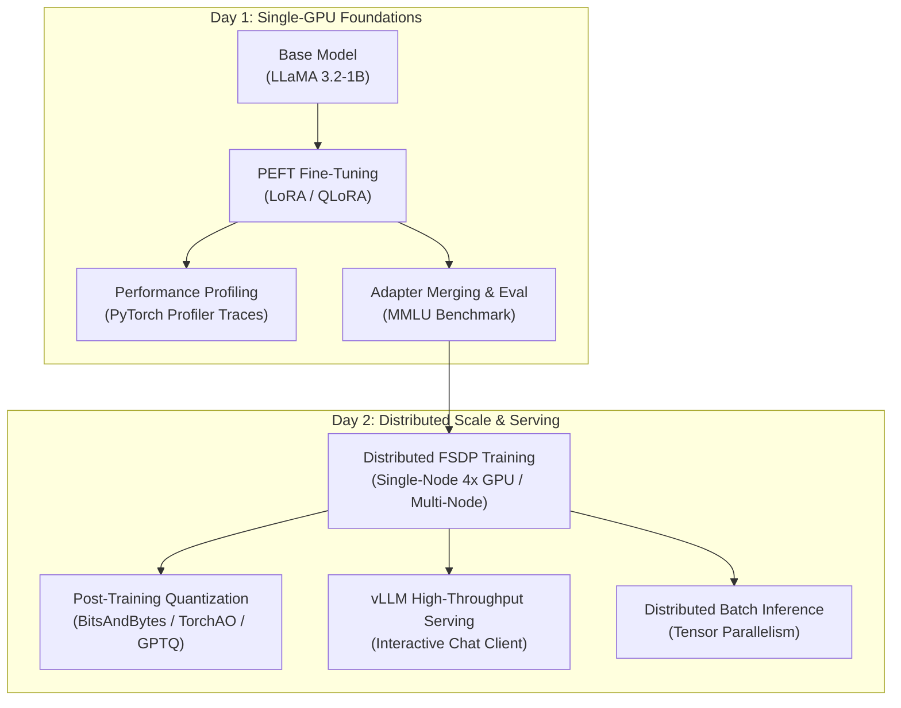

# LLM Fine‑tuning, Serving, and Inference on HPC

Welcome to the **LLM Fine‑tuning, Serving, and Inference on HPC** course! This repository provides a hands‑on guide to training, quantizing, evaluating, and deploying Large Language Models (LLMs) on High‑Performance Computing (HPC) clusters (specifically the **Olivia Supercomputer**).

All fine-tuning labs focus on **Question-Answering (QA)** using the Alpaca GPT-4 dataset.

---

## Course Overview

This course covers the full lifecycle of working with LLMs in an HPC environment—from single-GPU parameter-efficient fine-tuning (PEFT) to multi-node distributed training, post-training quantization, benchmark evaluation, and high-throughput vLLM serving.



## Course Program

### Day 1 — Single-GPU Fine-Tuning, Evaluation & Profiling
**Theme:** Build an efficient, reproducible single-GPU fine-tuning and evaluation workflow on an HPC system.

#### Morning Session (09:30–12:00) — HPC Fundamentals & Fine-Tuning Principles
- **HPC Foundations for LLM Workloads**
  - Architecture of the Olivia Supercomputer (NVIDIA Grace Hopper GH200 architecture)
  - Storage hierarchy: shared project shares, local `/tmp` scratch, and cache management
  - Software environments: Apptainer containers vs. native EESSI software modules
- **Parameter-Efficient Fine-Tuning (PEFT) Fundamentals**
  - Low-Rank Adaptation (LoRA): mathematical foundations, rank selection, and parameter efficiency
  - Quantized LoRA (QLoRA): 4-bit NormalFloat (NF4), double quantization, and dequantization
  - The Question-Answering (QA) benchmark task on the Alpaca GPT-4 dataset

#### Afternoon Session (13:00–15:30) — Hands-On: Single-GPU Workflow
- **End-to-End Fine-Tuning Workflow:**
  - Launching single-GPU LoRA and QLoRA fine-tuning jobs (Apptainer vs. EESSI)
  - Quantized fine-tuning trade-offs: FP4/NF4 memory savings vs. BF16 training throughput
- **Model Merging & Benchmark Evaluation:**
  - Merging trained LoRA adapter weights with base LLaMA weights into standalone Hugging Face checkpoints
  - Running MMLU benchmark evaluation with EleutherAI LM Evaluation Harness (comparing base model vs. fine-tuned adapter)
- **Performance Diagnostics & Monitoring:**
  - Real-time GPU monitoring with `gpu.monitor.sh` and interactive `nvitop`
  - Deep-dive PyTorch Profiler traces: memory timeline visualization and kernel analysis

#### Wrap-Up & Discussion (15:30–16:00)
**Outcome:** Participants implement, evaluate, and optimize a complete single-GPU QA fine-tuning pipeline with diagnostics, outputting structured artifacts to `results/checkpoint_results`, `results/profiling_results`, and `results/evaluation_results`.

---

### Day 2 — Distributed Training, Quantization, Serving & Inference
**Theme:** Scale fine-tuning across multiple GPUs and nodes, apply post-training quantization, and deploy high-throughput serving pipelines.

#### Morning Session (09:30–12:00) — Distributed Fine-Tuning, Evaluation & Profiling
- **Distributed Training Concepts & Interconnects**
  - PyTorch Fully Sharded Data Parallel (FSDP) vs. Distributed Data Parallel (DDP)
  - Inter-GPU interconnect topology: NVLink intra-node and HPE Slingshot / Cray Fabric inter-node
- **Hands-On: Multi-GPU & Multi-Node Fine-Tuning**
  - Single-node 4-GPU distributed LoRA, QLoRA, and Quantization-Aware Training (QAT-LoRA) with FSDP
  - Multi-node scaling across Slurm nodes with optimized AWS-OFI-NCCL network bindings
- **Hands-On: Distributed Evaluation & Profiling**
  - Multi-GPU MMLU evaluation of distributed checkpoints
  - Multi-rank profiling: identifying inter-GPU communication bottlenecks (all-reduce, reduce-scatter)

#### Afternoon Session (13:00–15:30) — Hands-On: Quantization, Serving & High-Throughput Inference
- **Hands-On: Post-Training Quantization (PTQ)**
  - Weight-only 4-bit and 8-bit quantization with BitsAndBytes
  - Modern kernel quantization using PyTorch TorchAO
  - Calibration-driven quantization with GPTQModel
- **Hands-On: LLM Serving with vLLM**
  - Deploying OpenAI-compatible vLLM API servers on single and multiple GPUs
  - Connecting and interacting with models via the terminal chat client (`chat.sh`)
- **Hands-On: High-Throughput Distributed Batch Inference**
  - Batch inference scaling with tensor parallelism in vLLM
  - Dynamic loading of trained LoRA adapters from `results/checkpoint_results/`

#### Wrap-Up & Discussion (15:30–16:00)
**Outcome:** Participants scale fine-tuned QA models across multiple GPUs and nodes, quantize models for edge/production constraints, evaluate performance on standard benchmarks, and deploy high-throughput vLLM serving on HPC clusters.

---

## Repository Layout

```text
llm-hpc-course/
├── course_env.sh    # THE single configuration file (account, reservation, paths, containers, modules)
├── setup_env.sh     # One-time setup: copies shared assets, creates folders, runs check_env.sh
├── run.sh           # Unified CLI runner for all Day 1 & Day 2 jobs
├── menu.sh          # Interactive terminal menu launcher
├── check_env.sh     # Pre-flight environment & directory health check
├── apptainer/       # Container definitions (.def), build guides, and launch scripts
├── configs/         # YAML configurations (LoRA, QLoRA, QAT-LoRA, and Evaluation)
├── day1_single_gpu/ # Single-GPU labs: Fine-Tuning, Evaluation, and Profiling
├── day2_multi_gpu/  # Multi-GPU labs: Distributed FT, Evaluation, Profiling, Quantization, Serving & Inference
├── recipes/         # Standalone Python recipes for training, merging, evaluation, quantization, and vLLM
├── utils/           # Cluster utilities (GPU monitor, nvitop, shared NCCL settings)
├── run_course.sh    # Run any command inside the PyTorch container (single / multinode)
└── README.md        # ← You are here
```

---

## Output Directory Structure (`results/`)

All training, profiling, and evaluation runs save outputs into organized subfolders under `results/`:

```text
results/
├── checkpoint_results/  # Checkpoints and adapter weights produced by fine-tuning
├── profiling_results/   # PyTorch Profiler JSON/HTML traces and training logs
├── evaluation_results/  # EleutherAI LM Evaluation Harness benchmark outputs (MMLU)
├── quantized_models/    # Your quantized models (Day 2 quantization lab)
└── benchmark_logs/      # vLLM serving benchmark results
```

Each job also writes its Slurm log to an `out/` folder next to the job script.

---

## Getting Started on Olivia (participants)

### 1. SSH to Olivia & Clone the Repo

```bash
ssh username@olivia.sigma2.no
mkdir -p /cluster/work/projects/nn9971k/$USER
cd /cluster/work/projects/nn9971k/$USER     # course workspace (any folder works)
git clone -b bergen-edition https://github.com/HichamAgueny/llm-hpc-course.git
cd llm-hpc-course
```

### 2. One-Time Setup

```bash
./setup_env.sh
```

This copies the shared models, datasets and container images into your course folder
(`./setup_env.sh --link` links them instead, which is instant and saves disk quota), creates the `results/` and
`out/` folders, and runs the pre-flight check (`./check_env.sh`, which you can re-run any time).
**You do not need to edit any path or account in any script.**

### 3. Run the Labs

You can run any lab using the **Interactive Menu**, the **Unified CLI Runner**, or plain `sbatch`.

#### Option A: Interactive Menu (Easiest)
```bash
./menu.sh
```

#### Option B: Unified CLI Runner (`./run.sh`)
Submit jobs from the repository root without navigating into deep directories:

```bash
# --- DAY 1 (Single GPU) ---
./run.sh day1 lora               # Submit single-GPU LoRA fine-tuning (Container)
./run.sh day1 lora --env=eessi   # Submit single-GPU LoRA fine-tuning (EESSI)
./run.sh day1 lora --with-eval   # Train AND automatically schedule evaluation when training succeeds!
./run.sh day1 qlora              # Submit single-GPU 4-bit QLoRA
./run.sh day1 eval               # Evaluate LoRA adapter on MMLU
./run.sh day1 profile            # Profile GPU memory and kernel execution

# --- DAY 2 (Multi-GPU Distributed) ---
./run.sh day2 ft-single          # 4-GPU distributed fine-tuning (single node)
./run.sh day2 ft-multi           # Multi-node distributed fine-tuning
./run.sh day2 eval               # Multi-GPU MMLU evaluation
./run.sh day2 quantize bnb4      # 4-bit BitsAndBytes quantization
./run.sh day2 serve              # Launch vLLM OpenAI-compatible server (--quant=bnb|gptq|torchao)
./run.sh day2 chat               # Connect interactive chat client to vLLM server
./run.sh day2 inference          # Distributed high-throughput batch inference

# --- UTILITIES ---
./run.sh monitor <JobID>         # Attach real-time GPU monitor to your active job
./run.sh status                  # Check active Slurm queue (squeue --me)
./run.sh help                    # All commands and options
```

#### Option C: Manual Slurm Submissions
Load the course settings **once per login** (this sets the Slurm account and reservation),
then submit from the lab folder:
```bash
source course_env.sh

cd day1_single_gpu/finetuning/lora_slurm/job_container
sbatch job_singleGPU_QA_LoRA.sh
```
After `source course_env.sh`, the GPU monitor also works from any folder: `gpu.monitor.sh <JobID>`.

### The Labs at a Glance

Step-by-step worksheets: [Day 1](./day1_single_gpu/README.md) · [Day 2](./day2_multi_gpu/README.md)

| Lab | Command (from the course folder) | Results |
| :--- | :--- | :--- |
| 1.1 LoRA fine-tuning (1 GPU) | `./run.sh day1 lora` | `results/checkpoint_results/llama3.2-1b_lora_single_device/` |
| 1.2 QLoRA fine-tuning (1 GPU) | `./run.sh day1 qlora` | `results/checkpoint_results/llama3.2-1b_qlora_single_device/` |
| 1.3 Profiling | `./run.sh day1 profile` | `results/profiling_results/` |
| 1.4 Merge + MMLU evaluation | `./run.sh day1 eval` (`--base` for the baseline) | `results/evaluation_results/` |
| 2.1 4-GPU fine-tuning | `./run.sh day2 ft-single --method=lora\|qlora\|qat-lora` | `results/checkpoint_results/*_multi_device/` |
| 2.2 Multi-node fine-tuning | `./run.sh day2 ft-multi --method=...` | `results/checkpoint_results/*_multi_node/` |
| 2.3 Distributed profiling | `./run.sh day2 profile --method=...` | `results/profiling_results/` |
| 2.4 4-GPU evaluation | `./run.sh day2 eval` | `results/evaluation_results/` |
| 2.5 Quantization | `./run.sh day2 quantize bnb4\|bnb8\|torchao\|gptq` | `results/quantized_models/` |
| 2.6 vLLM serving + chat | `./run.sh day2 serve`, then `./run.sh day2 chat` | (interactive) |
| 2.7 Batch inference | `./run.sh day2 inference` | Slurm log in `day2_multi_gpu/inference/out/` |

Add `--env=eessi` to use EESSI modules instead of the container. Every job's Slurm log is in the
`out/` folder next to its script, and each job prints where its results are when it finishes.

### Choosing which LoRA adapter to evaluate / serve

Evaluation, serving and inference use the Day 1 LoRA adapter by default
(`results/checkpoint_results/llama3.2-1b_lora_single_device/checkpoints/epoch_0`, or the EESSI
run if that is the only one). To use another adapter, set `LORA_PATH`:
```bash
LORA_PATH=$PWD/results/checkpoint_results/llama3.2-1b_lora_multi_device/checkpoints/epoch_0 ./run.sh day2 eval
```

---

## For Instructors: Configuring the Course

All course-wide settings live in **one file: [`course_env.sh`](./course_env.sh)**. Every job script,
`run.sh`, `menu.sh`, `setup_env.sh` and `check_env.sh` loads it, so nothing else needs editing.

| Setting | Variable in `course_env.sh` |
| :--- | :--- |
| Slurm account / reservation | `COURSE_SLURM_ACCOUNT`, `COURSE_SLURM_RESERVATION` (empty = no reservation) |
| Shared models, datasets, `.sif` images | `COURSE_ASSETS_DIR` (expects `shared/` and `apptainer/` inside) |
| Base model and dataset | `BASE_MODEL_NAME`, `BASE_MODEL_DIR`, `QA_DATASET_DIR` |
| Container images | `PYTORCH_SIF`, `VLLM_SIF` |
| EESSI module versions | `EESSI_MODULE`, `TORCHTUNE_MODULE`, `VLLM_MODULE`, `LM_EVAL_MODULE` |
| Multi-node NCCL / Slingshot paths | `NCCL_MODULE`, `HOST_*_PATH` |

The job scripts keep only what is specific to each lab: the `#SBATCH` resources, the run name,
the config file and the Python recipe. The account and reservation are *not* in the `#SBATCH`
headers: `sbatch` reads them from `SBATCH_ACCOUNT` / `SBATCH_RESERVATION`, which `course_env.sh`
exports (and `run.sh` also passes them explicitly).

After the course, submit without the reservation with
`COURSE_SLURM_RESERVATION= ./run.sh ...` or by emptying the value in `course_env.sh`.

---

## Documentation Links

- [Day 1 Guide: Single-GPU Workflow](./day1_single_gpu/README.md)
  - [Day 1 Profiling Guide](./day1_single_gpu/profiling/README.md)
- [Day 2 Guide: Multi-GPU & Distributed Workflow](./day2_multi_gpu/README.md)
  - [Day 2 Profiling Guide](./day2_multi_gpu/profiling/README.md)
- [Configuration Guide (`configs/`)](./configs/README.md)
- [Python Recipes Guide (`recipes/`)](./recipes/README.md)
- [Apptainer Container Guide (`apptainer/`)](./apptainer/README.md)
- [Utilities & Monitoring Guide (`utils/`)](./utils/README.md)

---

## Contact
**Hicham Agueny** — [GitHub Profile](https://github.com/HichamAgueny)
